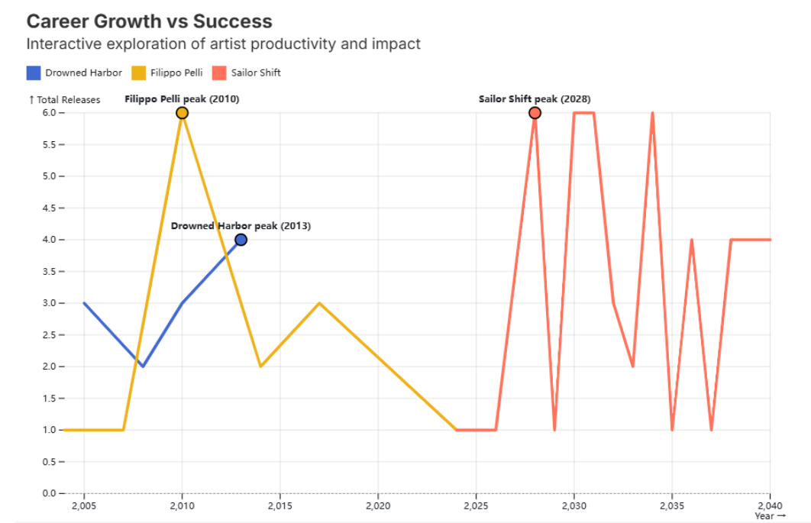
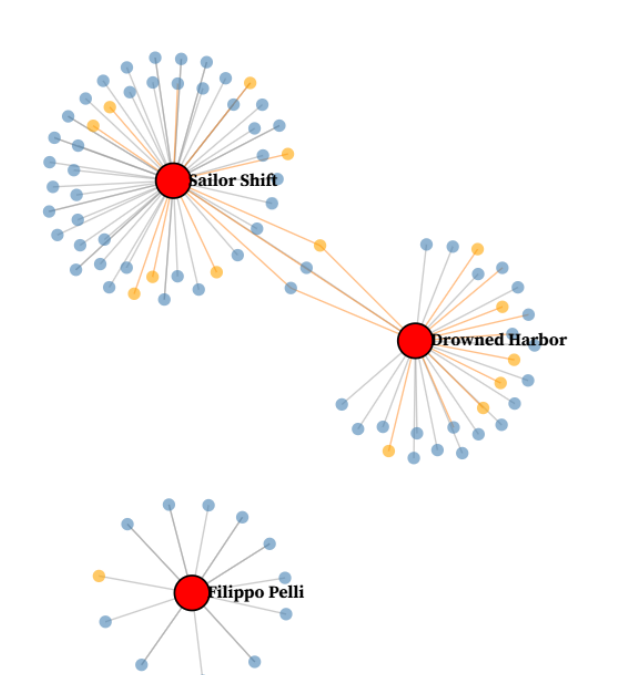
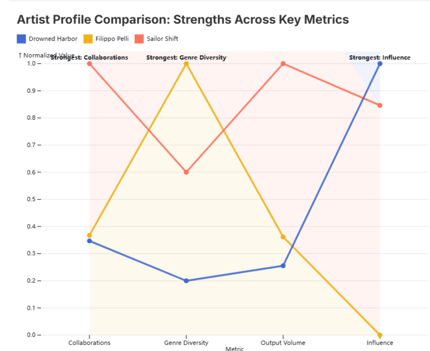
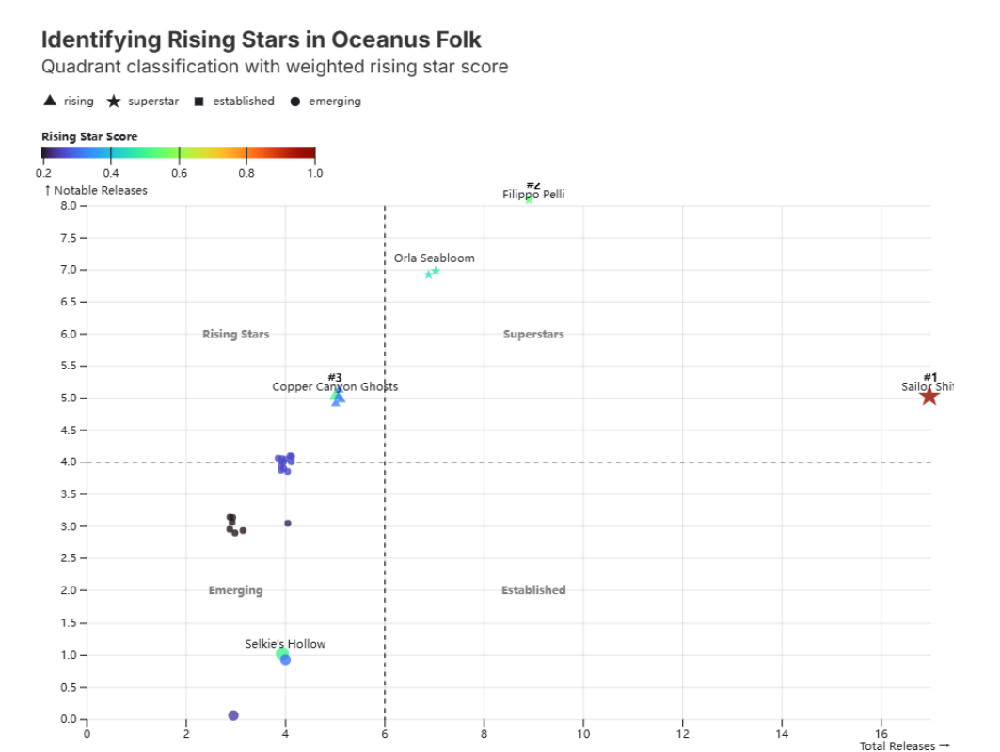

# Oceanus Folk: finding rising stars

Interactive visualisations of a fictional music knowledge graph, built in Observable (Observable Plot and D3) with the data prepared in R.

This was a three-person group coursework for COMP3087 (University of Nottingham). This repository contains **my part, Task 3 (Oceanus Folk artist analysis)**: the data preparation, the four visualisations and the written design rationale. Tasks 1 and 2 were completed by teammates and are not included.

## The question

Which Oceanus Folk artists show the strongest potential to become the next star, and how do their careers, collaborations and influence compare with an established star?

## What I did

- Filtered the knowledge graph to Oceanus Folk songs and linked them to the people and groups who performed, composed, produced or wrote them.
- Built per-artist measures in R: total releases, notable releases, career length and recent activity (releases from 2035 onwards).
- Combined them into a rising-star score that gives extra weight to recent activity: `score = 3 x recent activity + 1.5 x notable releases + 0.5 x total releases`.
- Built a collaboration and influence network for three contrasting artists, and four visualisations that explore the results.
- Wrote up the design choices, drawing on Cleveland and McGill (1984) and Munzner (2014).

## The visualisations

### 1. Career growth vs success
A timeline of each artist's releases per year. Readers can switch between total and notable releases and highlight one artist, and each artist's peak or breakthrough year is annotated.

### 2. Collaboration and influence network
A force-directed graph. Grey links are collaborations and orange links are influence. Hovering over a node highlights its connections. Sailor Shift is the main hub, Drowned Harbor is smaller, and Filippo Pelli is not directly connected to Sailor Shift in the filtered graph.

### 3. Artist profile comparison
Four measures (collaborations, genre diversity, output volume and influence) scaled from 0 to 1 so that artists can be compared fairly. Each artist's strongest measure is labelled.

### 4. Identifying rising stars
Artists are placed by total releases and notable releases, split at the medians into four groups: rising, superstar, established and emerging. Colour shows the rising-star score. The notebook lists Copper Canyon Ghosts, Selkie's Hollow and The Brine Choir as predicted rising stars.

## Limitations

- The score weights were chosen by hand to favour recent activity. They were not fitted to data or validated.
- "Recent" is a fixed cut-off (2035 onwards), so the ranking depends on that choice.
- The predictions were not tested against later outcomes, because the data does not include them.
- The three artists in the network and profile charts were selected with simple rules, so they illustrate the method rather than prove it.

## Repository contents

| Path | What it is |
|---|---|
| `R/rising_stars_prep.R` | R script that prepares the data for the notebook |
| `images/` | Screenshots of the four visualisations |
| `docs/task3-notebook-printout.pdf` | Printout of my Task 3 notebook pages, including the code and the write-up |

## Running the R script

The data file (`data.json`) was provided with the module and is not included here.

1. Install R and the packages `jsonlite`, `dplyr` and `tidyr`.
2. Put `data.json` in the same folder as the script.
3. Run `Rscript rising_stars_prep.R`.

It writes `timeline.csv`, `network.json`, `metrics.csv` and `potential_stars_all.csv`, which the Observable notebook reads.
